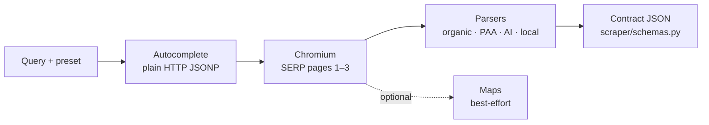

# 01 Flow — query in, JSON out

## 1. Entry points

- Viewer: `GET /` serves `ui/index.html`. Static mounts in `api.py:354-373`.
- Full run: `GET /api/scrape` in `api.py:239-267`. Params: `q, preset, hl, gl, domain, location, city, state, country, uule, pages 1-3, include_maps, mock, solve, headless`.
- Streamed run: `GET /api/scrape/stream` in `api.py:274-351`. Emits `{"type":"stage"}` then `{"type":"result"}`. Viewer uses `EventSource` in `ui/app.js:239-264`.
- Helpers: `/api/autocomplete`, `/api/locales`, `/api/demo-keywords`, `/api/session`, `/api/solver`, `/api/health` in `api.py:166-237`.

## 2. Run order

1. Resolve locale: `_resolve_params` in `api.py:89-138` merges preset + explicit `hl/gl/domain/location` + `uule`.
2. Autocomplete over plain HTTP: `fetch_autocomplete` in `scraper/autocomplete.py:15`, called in `scraper/runner.py:268-280`. No browser.
3. Search pages 1-3 in one Chromium context: `collect_search` in `scraper/serp.py:1156`, orchestrated in `scraper/runner.py:282-294`. Fixed desktop fingerprint, HTTP/1.1 only, media blocked.
4. Challenge handling: `classify_block` in `scraper/serp.py:140`, CapSolver loop up to 3 attempts with reload for fresh challenge.
5. Parse blocks: organic, related/PASF, PAA, AI Overview/AI Mode, local pack. Off-query AI-Mode triggers classic `udm=14` refetch.
6. Maps best-effort pass: `collect_maps` in `scraper/maps.py:122`, called in `scraper/runner.py:296-314`. Never fails whole run.
7. Session reuse + retry: sticky sessid + cookies up to 25 min, exit-IP check, one fresh-session retry on blocked run in `scraper/runner.py:342-471`.
8. Mock shortcut: `mock=1` serves `samples/sample_result.en.json` or `.ja.json` in `scraper/runner.py:541-556`.

## 3. Illustration

- `assets/serpkit-illustrations/01-run-pipeline.svg` (Fig 1)
- Placement: after this chapter.
- Layout: left-to-right chain — Query → Autocomplete (HTTP JSONP) → Chromium (pages 1–3) → Parsers → Contract JSON; Maps as a blue dotted optional branch.
- Xiaohei: accent at the Parsers → JSON junction, plugging the final cable. Caption "one contract every run".
- Why: one figure for the whole pipeline; details live in later chapters.
