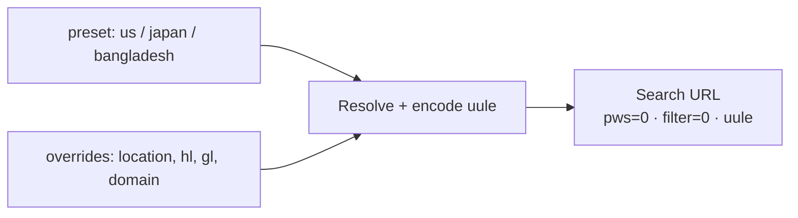
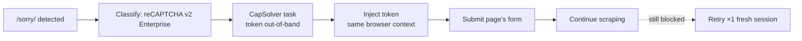

# 02 Mechanism — how each piece works

## 2.1 Locale and URLs

- Presets in `scraper/config.py:68-99`: `us` (`www.google.com`, `en/us`), `japan` (`www.google.co.jp`, `ja/jp/lang_ja`, Tokyo), `bangladesh` (`www.google.com.bd`, `en/bd`, Dhaka).
- `resolve_preset` in `scraper/config.py:104-106`, `parse_location` in `scraper/config.py:464-490` (alias, `City,Country`, canonical `City,Region,Country`), `build_uule` in `scraper/config.py:415-428`, `canonical_location_uule` in `scraper/config.py:431-439`.
- Builders: `build_search_url` in `scraper/config.py:493-508` (`pws=0`, `filter=0`, optional `lr`, `uule`, `udm=14`), `build_autocomplete_url` in `scraper/config.py:511-514`, `build_maps_search_url` in `scraper/config.py:517-518`.
- Auto-gl switch for bd/jp/us in `api.py:117-119`.

- Illus `02-locale-resolution.svg` (Fig 2): preset chips → merge → resolve/encode box → Search URL chip. Xiaohei flips the preset switch ("pick locale").

## 2.2 Egress and sessions

- `ProxyConfig` in `scraper/config.py:177-295`: `server`, `username/password`, `session_template`, `targeting_template`, `username_template`. Canonical DataImpulse sticky `:823` + `{username}__cr.{country};sessid.{run_id}`.
- Guards: `validate_proxy_for_google` in `scraper/config.py:325-344` (Bright Data blocked), `validate_proxy_config` in `scraper/config.py:347-389` (sessid vs sessttl mix, geo warnings).
- Session store in `scraper/sessions.py:35-76`: `Session` (`sessid`, `created_at`, `exit_ip`, `state`), `SessionManager.load/create/save/clear`, per-preset lock, TTL 1500s, `.sessions/` dir.
- Reuse flow in `scraper/runner.py:368-406`: pace gap, cached IP-pin check, silent peer-swap rotation, warmup on homepage.
- Illus `03-session-lifecycle.svg` (Fig 3): loop — session store → run queries → exit-IP check → "same IP?" decision → reuse (≤25 min) or rotate + warmup; persist state feeds back to the store. Xiaohei is the watchman with magnifier verifying the exit IP ("verify").

## 2.3 Fingerprint and solver

- Launch in `scraper/serp.py:87`: system Chrome channel, real UA via `browser_user_agent` in `scraper/serp.py:69`, remove `--enable-automation`, add `--disable-blink-features=AutomationControlled`, `--disable-http2`.
- Pre-load patch in `scraper/config.py:535-568`: webdriver undefined, languages, chrome stub, hardwareConcurrency, WebGL SwiftShader mask, permissions query.
- Pacing: `MIN_PAGE_DELAY_S/MAX_PAGE_DELAY_S` in `scraper/config.py:111-114`, PAA click jitter 800-1600ms. Media blocked in `scraper/serp.py:55-56`.
- Challenge: `classify_block` in `scraper/serp.py:140`, `SOLVABLE_KINDS` in `scraper/serp.py:42`, `build_solve_policy` in `scraper/runner.py:212-230`, `SolvePolicy` in `scraper/serp.py:206`. Budget 3/run, min interval, timeout 130s. Token injected in-context, form submitted.
- Illus `04-captcha-loop.svg` (Fig 4): /sorry/ → classify (v2 Enterprise) → CapSolver task → inject token → submit + continue; bracket "max 3/run · reload per fresh challenge". Red note: no key → `solver_not_configured`, fail loud. Blue note: retry ×1 with fresh session. Xiaohei cranks the attempts ratchet ("attempt ≤ 3").

## 2.4 Parsers

- Selectors isolated in `scraper/selectors.json`. Structure-based, fallback chains.
- `parse_organic` in `scraper/serp.py:441` (pages 1-3, dedupe, off-query drop via `organic_off_query` in `scraper/serp.py:949`), `parse_related_searches` in `scraper/serp.py:518`, `parse_people_also_search_for` in `scraper/serp.py:536`, `detect_module_heads` in `scraper/serp.py:572`, `parse_paa` in `scraper/serp.py:582` + `expand_paa` in `scraper/serp.py:855`, `parse_ai_overview` in `scraper/serp.py:679` + `wait_for_ai_panel` in `scraper/serp.py:901` + `expand_ai_overview` in `scraper/serp.py:925`, `parse_local_pack` in `scraper/serp.py:729`, `parse_has_next` in `scraper/serp.py:788`, `parse_maps_cards` in `scraper/maps.py:29`.
- PAA answers stay empty when Google rejects async endpoint — honest empty, not guessed. AI kept only when `text_blocks` non-empty (`scraper/schemas.py:42-43`).
