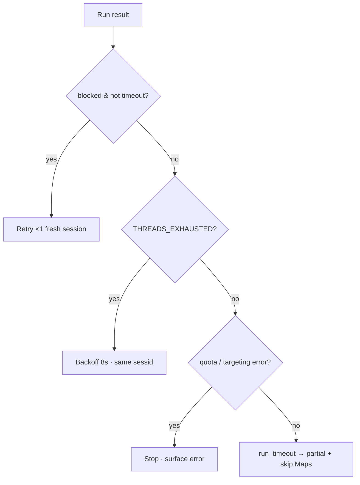

# 03 Process — run lifecycle and recovery

## 3.1 Step-by-step

1. Session gate: `run_full_scrape` in `scraper/runner.py:342-471`. Disabled path returns early in `scraper/runner.py:361-366`.
2. Autocomplete: `scraper/runner.py:268-280`, timed in `timing_ms.autocomplete_ms`.
3. Search: `collect_search` with `storage_state`, `warmup`, `deadline`, `ip_check`, `expected_exit_ip` in `scraper/runner.py:284-294`. Progress via `emit_progress` in `scraper/serp.py:45-53`, stages `session/autocomplete/organic/ai/paa/related/pages/maps/finalize` (`ui/app.js:190-193`).
4. Maps: `scraper/runner.py:296-314`, `maps_zero_result` suppressed when no local intent.
5. Finalize: `ScrapeResult` build in `scraper/runner.py:319-336`, `timing_ms.total_ms`, `run_id`.

## 3.2 Failure taxonomy and retry

- Proxy quota first, no rotation:
  - `THREADS_EXHAUSTED` → backoff same sessid, retry once (`_has_proxy_threads_exhausted`, `_proxy_thread_backoff_s` in `scraper/runner.py:126-145`).
  - `TRAFFIC_EXHAUSTED / USER_RATE_LIMIT` → fail fast, clear session (`scraper/runner.py:131-134`).
  - Targeting/port errors → fail fast (`scraper/runner.py:136-137`).
- Blocked (`_is_blocked` in `scraper/runner.py:190-198`: no organic + `captcha_v2/captcha_image/consent/unusual_traffic/zero_result`) → one fresh-session retry (`scraper/runner.py:439-456`), unless `run_timeout`.
- Deadline: `run_timeout_s` in `scraper/config.py:123-128` (default 600s), checked in page fetch + solver, partial data + `run_timeout` error, Maps skipped past deadline.
- Mid-run IP probe: light ipify check (`_session_ip_check_light` in `scraper/runner.py:87-99`), emits `note` event on change.

## 3.3 Debugging

- `SERP_DEBUG_HTML_DIR` saves captured HTML; zero-result runs auto-capture for selector repair.
- `timing_ms.heads` records which of paa/pasf/related were served — absence is provable.
- `/api/session` shows TTL, exit IP/geo, runs, UA. `/api/solver?balance=1` capped 10s. `/api/health` in `api.py:166-176` aggregates all.
- Viewer watchdog sized from `run_timeout_s + 60s`.

## 3.4 Illustration

- `assets/serpkit-illustrations/06-failure-handling.svg` (Fig 6)
- Layout: error-state column (real codes in mono) → action column: `pages_fetched=0 ∧ blocked` → Retry once fresh session; `THREADS_EXHAUSTED` → backoff same sessid; `TRAFFIC_EXHAUSTED / NO_RAY / PORT_*` → stop (red); `run_timeout` → partial, skip Maps (blue).
- Xiaohei: accent on the retry path, pulling the lever on the action box ("one retry").

