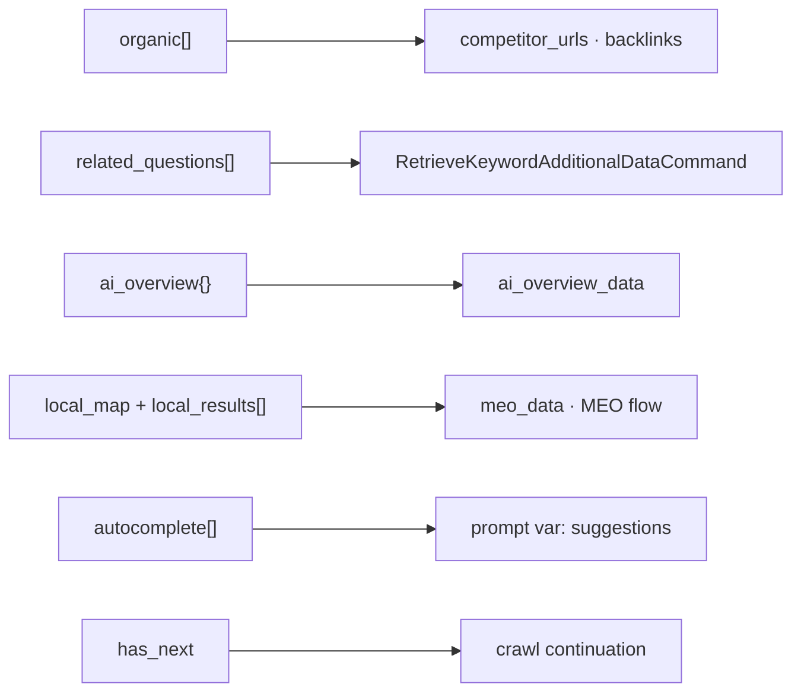

# 04 Finalization — contract, handoff, limits

## 4.1 Frozen contract

Defined in `scraper/schemas.py:71-88` (`ScrapeResult.to_dict` in `scraper/schemas.py:89-90`):

- `organic[{position,title,link,snippet}]`, `related_searches[]` (merged related + PASF, deduped in `scraper/serp.py:563-570`), `related_questions[{question,snippet,link}]`, `ai_overview{text_blocks,links[,source]}` or `None`, `local_map{present,count}` + `local_results[]`, `autocomplete[]`, `maps_local_results[]`, `has_next`, `pages_fetched`, `solves[]`, `timing_ms`, `errors[]`, `mock`.
- Rules: AI kept only when `text_blocks` non-empty; Maps `website` needs place-page pass; PAA snippet may stay empty; duplicates dropped across pages.

## 4.2 Laravel handoff

Mapping in `docs/MAPPING.md:6-16`:

- organic → competitor URLs / `competitor_urls` / backlink prospecting pages 1-3.
- related_searches → `related_searches` prompt var.
- PAA → `RetrieveKeywordAdditionalDataCommand.related_questions_data`.
- AI → `ai_overview_data` (`source: ai_mode` when AI Mode panel).
- local pack → `meo_data` / MEO flow; autocomplete → `suggestions`; Maps → maps/MEO flow.
- Call shape: `GET /api/scrape?q=&hl=ja&gl=jp&domain=www.google.co.jp&city=Tokyo&...&pages=3&include_maps=1`.
- End state: sidecar Python behind Laravel HTTP/queue per `docs/PHP_PORT.md` — PHP has no official Playwright, Panther/Selenium stealth weaker. Keep API fallback for burst/blocked periods.

## 4.3 Limits (say plainly)

- PAA answers behind async endpoint rejected for fresh sessions — questions yes, answers empty.
- AI Overview varies by query/session by design.
- PAA/PASF/related are layout/session dependent; `timing_ms.heads` proves absence.
- Solve acceptance probabilistic; amortized to ~1 per 25-min window via reuse.
- Selector upkeep ongoing; classes rotate, `selectors.json` + fallback chains + alarming.

## 4.4 Illustration

- `assets/serpkit-illustrations/05-contract-to-seo-api.svg` (Fig 5)
- Layout: two panels — "Frozen contract" (field names in mono) and "seo_api consumers", connected by one orange arrow labeled "same field names". Xiaohei stamps the contract "stamped frozen" between the panels.

